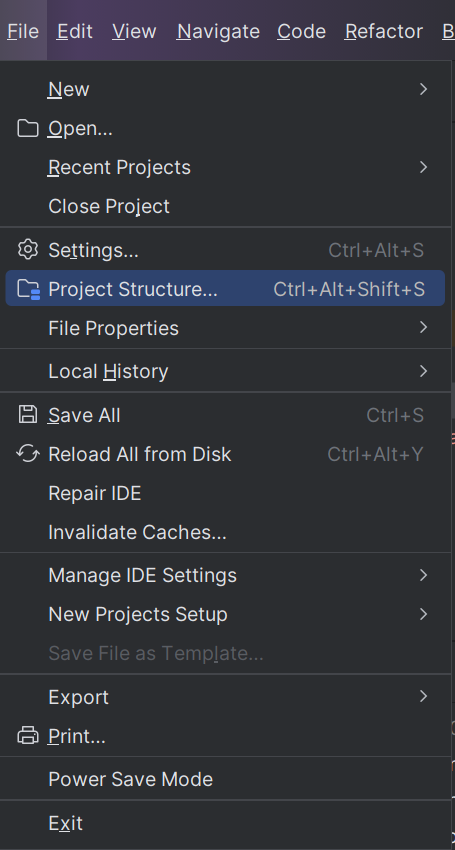
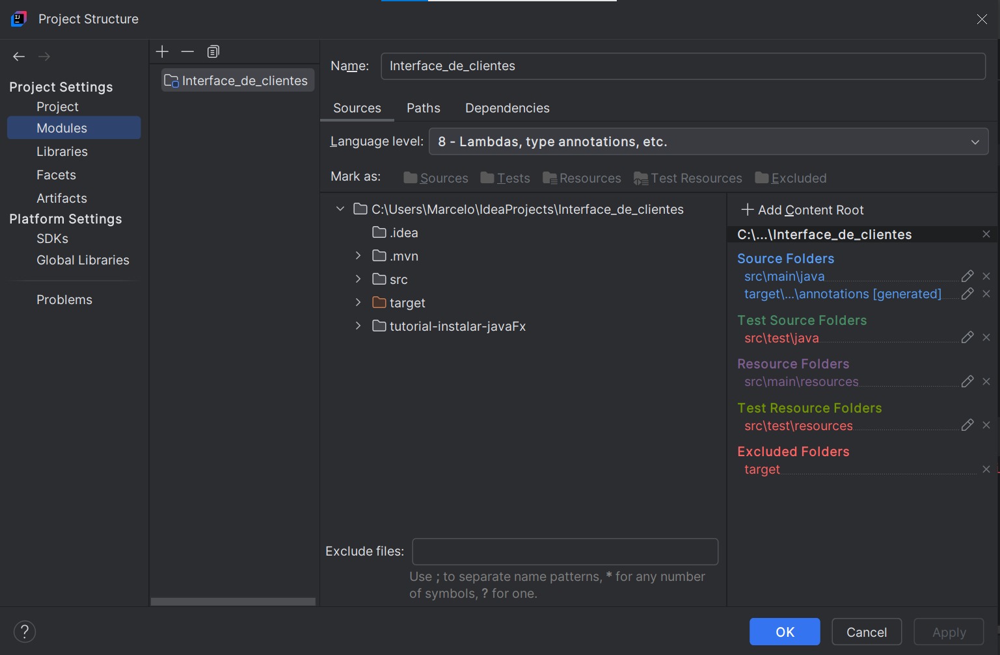
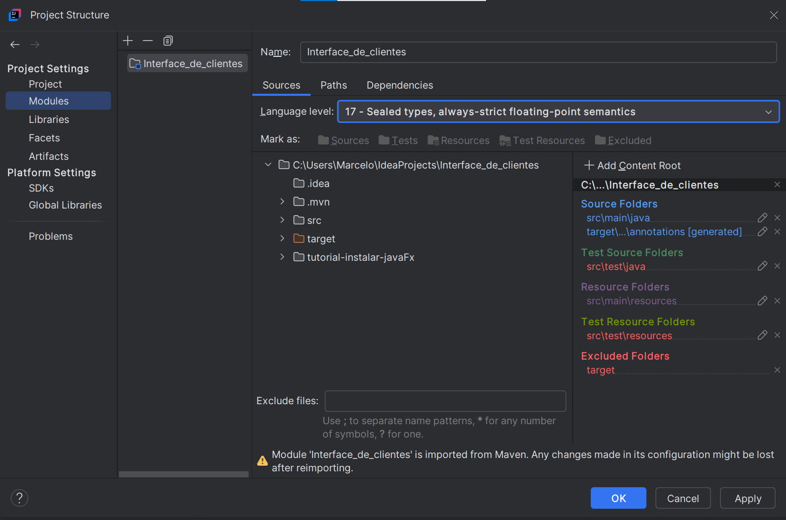
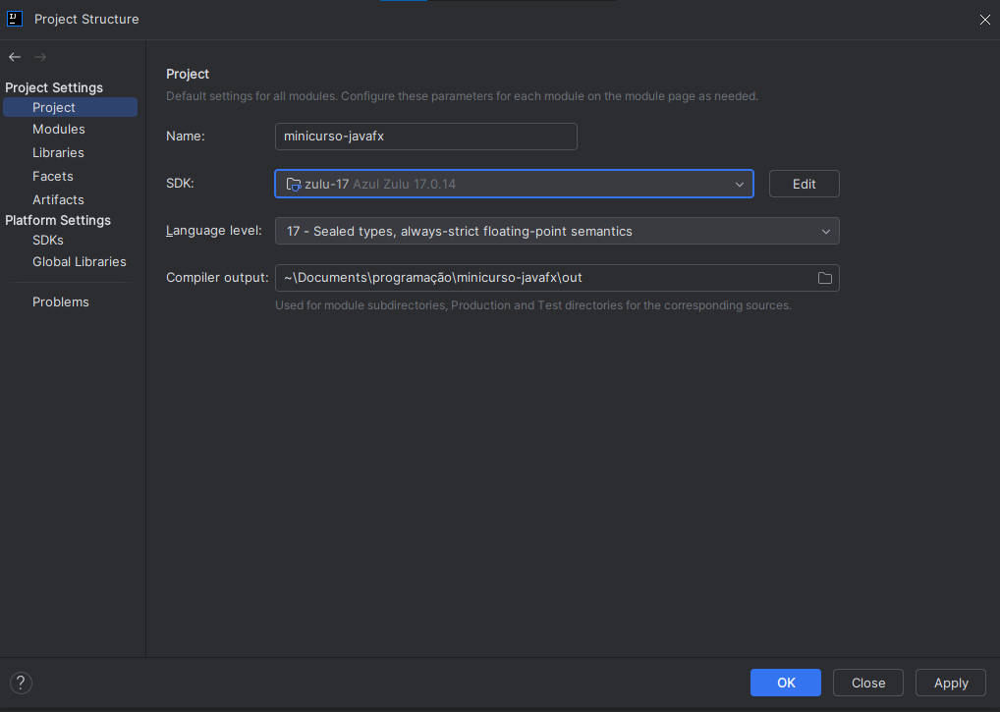
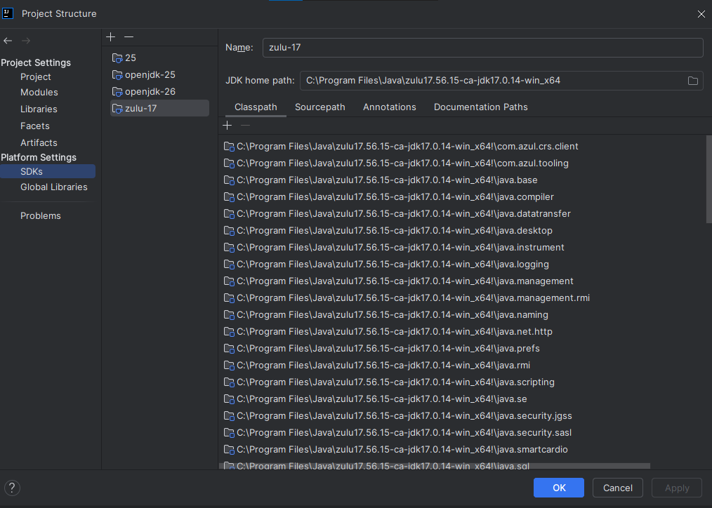
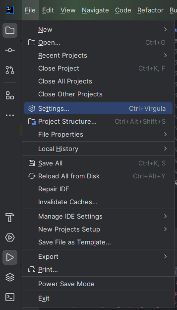
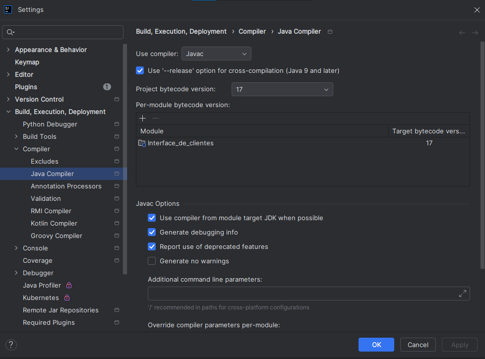

# Introdução a JavaFx: Construindo uma interface pra cadastro de clientes

Este repositório é o material do minicurso Introdução a JavaFx: Construindo uma interface pra cadastro de clientes, que fará parte da do evento de tecnologia WeekIT, que ocorrerá durante a semana de tecnologia no IFBA campus Vitória da conquista.
O projeto será desenvolvido no InteliJ 

## Pré requisitos
- **JDK Java 17+**: De preferencia a versão mais nova
- **SceneBuilder**
- InteliJ
**Obs:** Na versão mais nova do InteliJ não é preciso instalar o JavaFx por fora, mas caso a versão da maquina no aluno seja a community edition, é necessario instalar o JavaFX manualmente,
  segue-se o manual em [docs/tutorial-instalar-javafx](docs/tutorial-instqlar-javafx)

## Objetivo
O objetivo do minicuros é introduzir os alunos ao JavaFx, mostrando:
- A contrução das telas/arquivos fxml utilizando o SceneBuilder;
- Como conectar os elementos e eventos de uma tela a respectiva classe controller
- Como fazer a troca de telas de forma simplificada
- Como utilizar o recurso do Alert de modo inteligente

Infelizmente devido ao tempo curto, n será possivel estilizar a interface utilizando css, mas acredito que os itens acima ja são o suficientes pra qualquer pessoa utilizar o framework de modo inteligente

## Passo a passo do mini curso

## Possiveis bugs durante a execução
Antes de executar o proketo, é necessarios verificar se em todas as configuraçoes a versão do java utilizada é 17+ e compartivel com seu projeto. O ideal é que em diferentes configuraçoes 
seja considerado a mesma versão do Java

### Configuraçoes em Project Structure

#### Module
Em Module deve-se atribuir a Language Level a numero da mesma vesão do jdk utilizada no projeto, no caso do nosso 
projeto, 17+. O ideal é dexar prject Default, pq vai ser o msm numero do JDk utilizado 

Versão não compativel com nosso projeto

Versão correta

#### Project
Verificar se SDK e Language Level são 17+

#### SDK's
Verifcar se há uma versão 17+ instalada

### Configuração em Settings
Vá em settings

Em seguida vá em **Build, Compiller, Execution** > **Compiller** > **Java Compiler**. Na tela que aparecer mude
*Project bytecode version* e *Target bytecode version* para 17+ ou Project Default.

Caso, durante a execução do projeto, apareça algum erro, feche a IDE, abra de novo, e refaça a modificação

