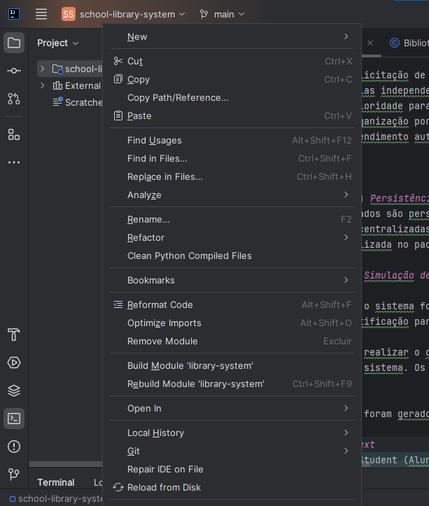
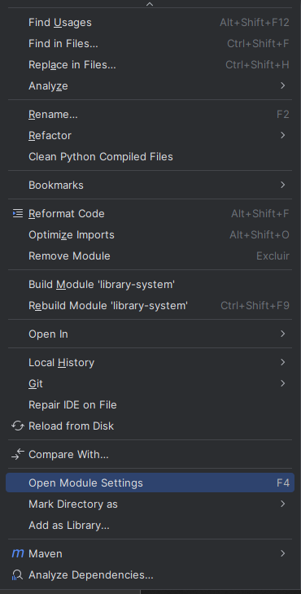
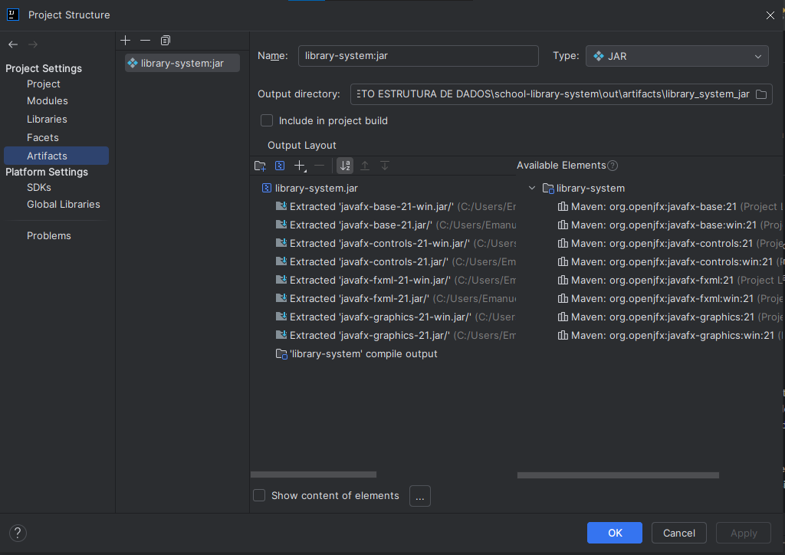
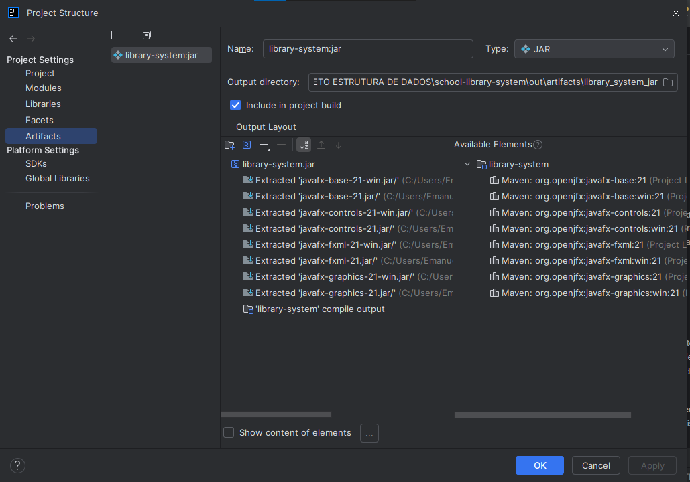

# Criando o arquivo JAR do projeto Java e JavaFX

Este tutorial apresenta duas formas de gerar o arquivo `.jar` do projeto Java/JavaFX: utilizando os recursos da IDE **IntelliJ IDEA** e utilizando o **Maven**.

O arquivo `.jar` permite empacotar a aplicação em um único arquivo, facilitando sua distribuição e execução em outras máquinas.

> **OBSERVAÇÕES**
>
> * Para executar o `.jar`, é necessário que o **Java esteja instalado** na máquina.
> * A versão do Java instalada deve ser **compatível com a versão utilizada para compilar o projeto**. Em geral, uma versão mais nova do Java consegue executar aplicações compiladas para versões anteriores, mas o contrário não é garantido.
> * Sempre que houver alterações no código ou nos recursos do projeto, é necessário **gerar um novo `.jar`** para que a versão distribuída contenha as atualizações.
> * Em projetos JavaFX, além do Java, é necessário garantir que as dependências do JavaFX estejam corretamente configuradas para a execução da aplicação.

---

## Pela IDE IntelliJ IDEA

### Passo 1 — Abrir o Project Structure

Na janela do projeto, clique com o botão direito sobre a pasta raiz do projeto.



### Passo 2 — Acessar o Module Settings

Procure pela opção **Open Module Settings** e clique nela.



### Passo 3 — Acessar a opção Artifacts

Na janela **Project Structure**, selecione a opção **Artifacts** no menu lateral.



### Passo 4 — Gerar o arquivo JAR

Na configuração do *Artifact*, selecione a opção **Include in project build**.

Em seguida, clique em **Apply** e depois em **OK**.



Depois disso, utilize a opção de **Build** da IntelliJ para gerar o projeto.

O arquivo `.jar` será criado dentro da pasta `out/artifacts/`.

A estrutura será semelhante a:

```text
out/
└── artifacts/
    └── nome-do-projeto_jar/
        └── nome-do-projeto.jar
```

Para executar a aplicação, basta acessar a pasta, localizar o arquivo `.jar` e executá-lo.

> **Importante:** dependendo da configuração do projeto, principalmente em aplicações JavaFX, o `.jar` gerado pela IntelliJ pode não conter todas as dependências necessárias para execução em outra máquina. Para projetos Maven, recomenda-se utilizar o próprio Maven para realizar o empacotamento.

---

## Pelo Maven

Para projetos que utilizam **Maven**, a geração do `.jar` pode ser realizada diretamente pelo terminal, sem depender da IDE.

### Passo 1 — Abrir o terminal

Abra um terminal na pasta raiz do projeto, onde está localizado o arquivo:

```text
pom.xml
```

A estrutura deve ser semelhante a:

```text
school-library-manager/
├── src/
├── data/
├── pom.xml
└── README.md
```

### Passo 2 — Gerar o projeto

Execute o seguinte comando:

```bash
mvn clean package
```

O Maven irá:

1. Remover arquivos gerados anteriormente;
2. Compilar o código-fonte;
3. Executar os testes configurados;
4. Empacotar a aplicação;
5. Gerar o arquivo `.jar`.

Após a execução do comando, o arquivo será criado dentro da pasta `target/`.

Exemplo:

```text
target/
├── classes/
├── test-classes/
└── nome-do-projeto.jar
```

### Passo 3 — Executar o JAR

Depois que o `.jar` for gerado, é possível executá-lo pelo terminal utilizando:

```bash
java -jar target/nome-do-projeto.jar
```

Substitua `nome-do-projeto.jar` pelo nome real do arquivo gerado.

Também é possível executar o arquivo diretamente pelo sistema operacional, caso a associação de arquivos `.jar` com o Java esteja configurada corretamente.

---

## Gerando uma nova versão do JAR

Sempre que o projeto receber alterações, é necessário gerar novamente o arquivo `.jar`.

Para isso, basta executar:

```bash
mvn clean package
```

O Maven irá substituir os arquivos gerados anteriormente por uma nova versão baseada no código atualizado.

Caso o projeto utilize um `.jar` na raiz para facilitar a distribuição, o novo arquivo gerado em `target/` pode ser copiado para a raiz do projeto após cada atualização.

Por exemplo:

```text
target/
└── school-library-manager.jar
```

Pode ser copiado para:

```text
school-library-manager/
├── src/
├── data/
├── target/
├── school-library-manager.jar
└── pom.xml
```

Dessa forma, o arquivo `.jar` disponível na raiz representa a versão pronta para distribuição.

---

## Qual método utilizar?

Para projetos Maven, recomenda-se utilizar o **Maven** para gerar o `.jar`, pois o processo fica padronizado e pode ser repetido facilmente em qualquer ambiente que possua o Maven e o Java configurados.

O IntelliJ é útil para gerar rapidamente um `.jar` durante o desenvolvimento, mas o Maven é mais indicado para um processo de **build e distribuição** do projeto.

```bash
mvn clean package
```

é, portanto, o comando principal para gerar uma nova versão do projeto.
